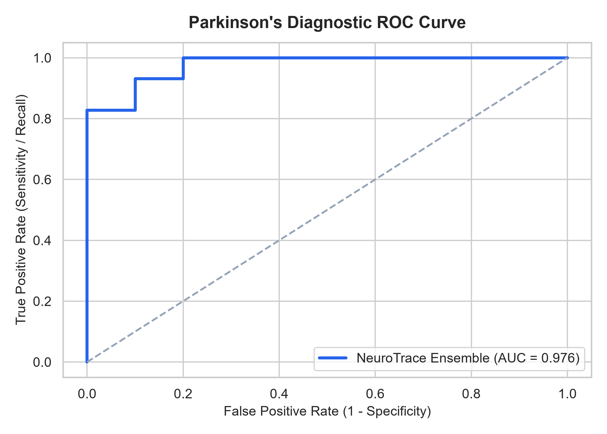
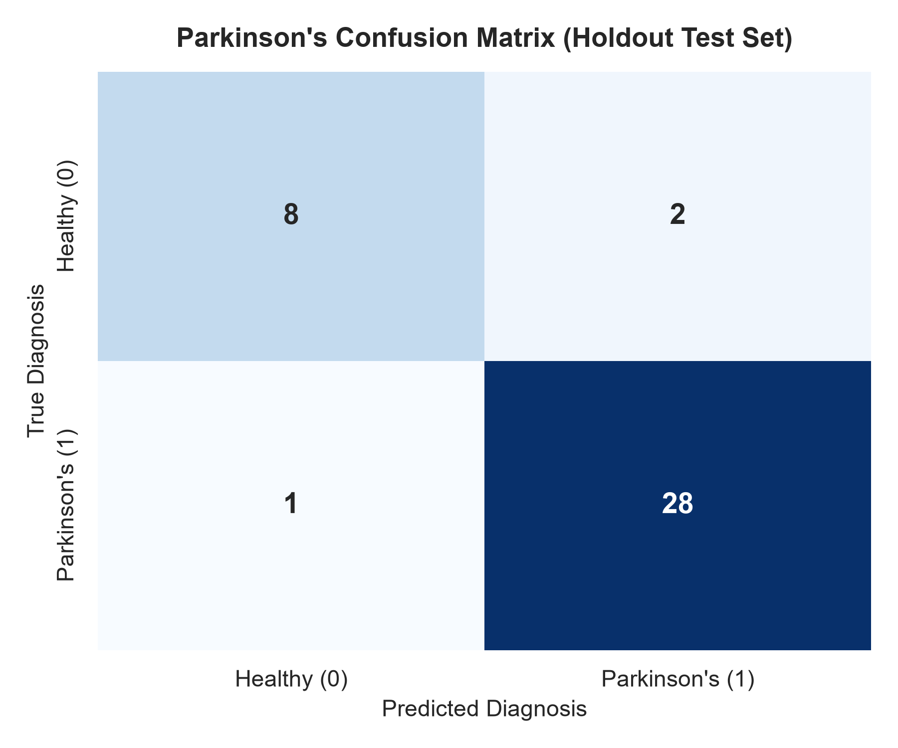
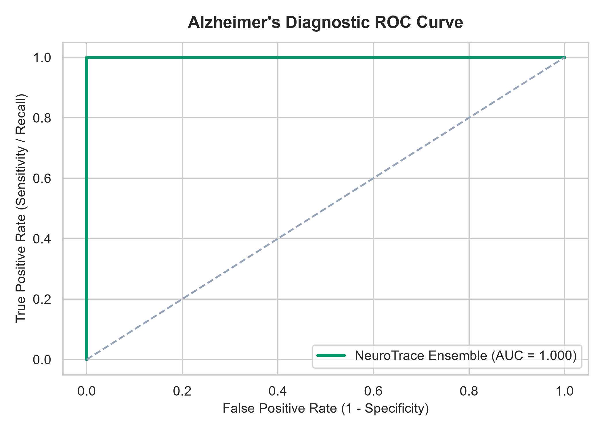
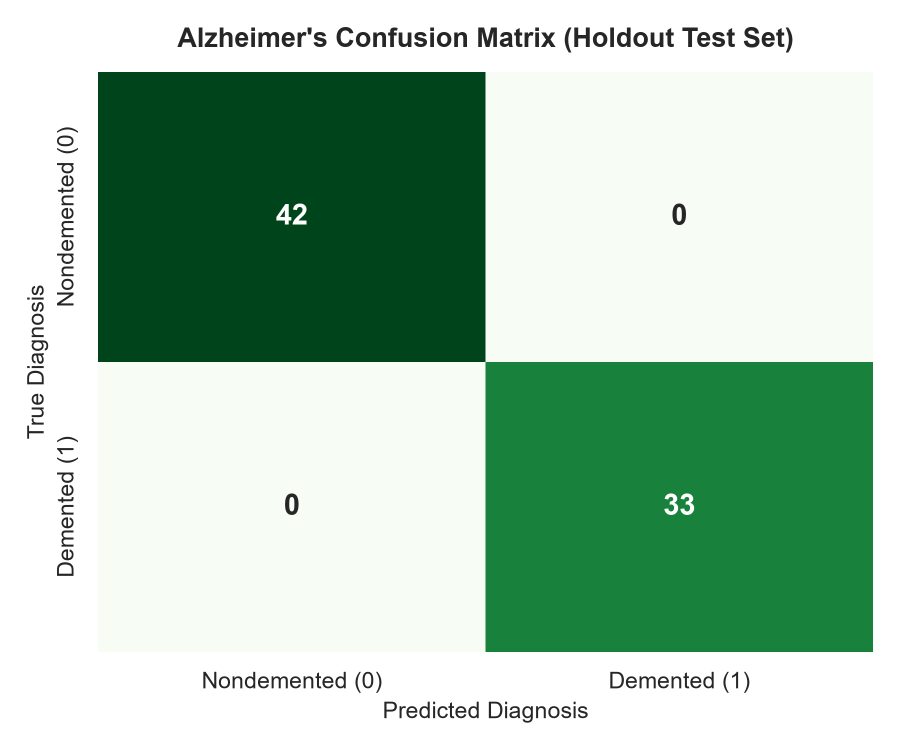
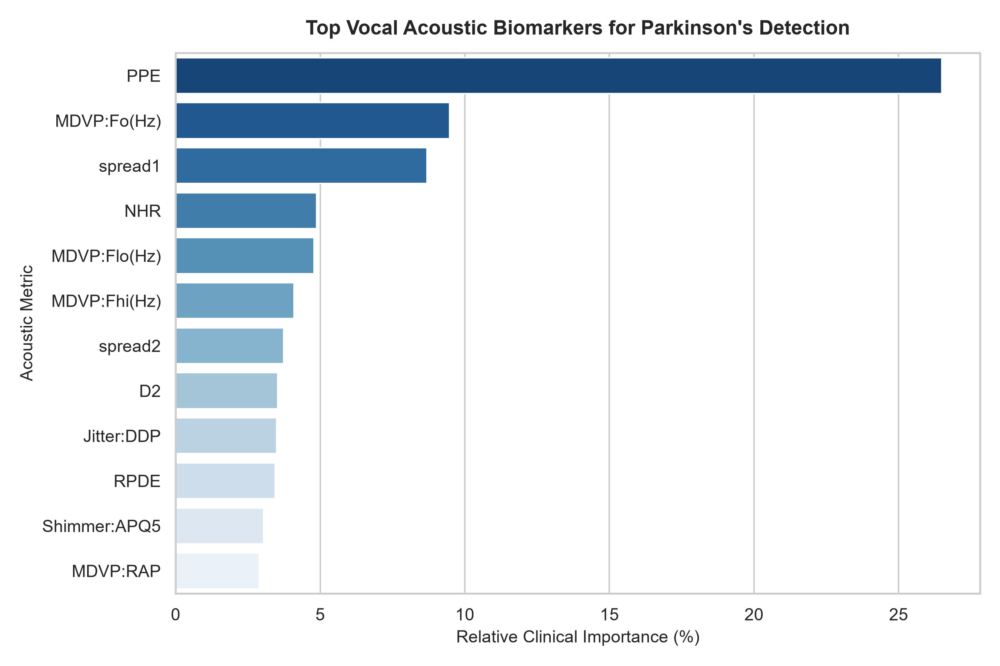
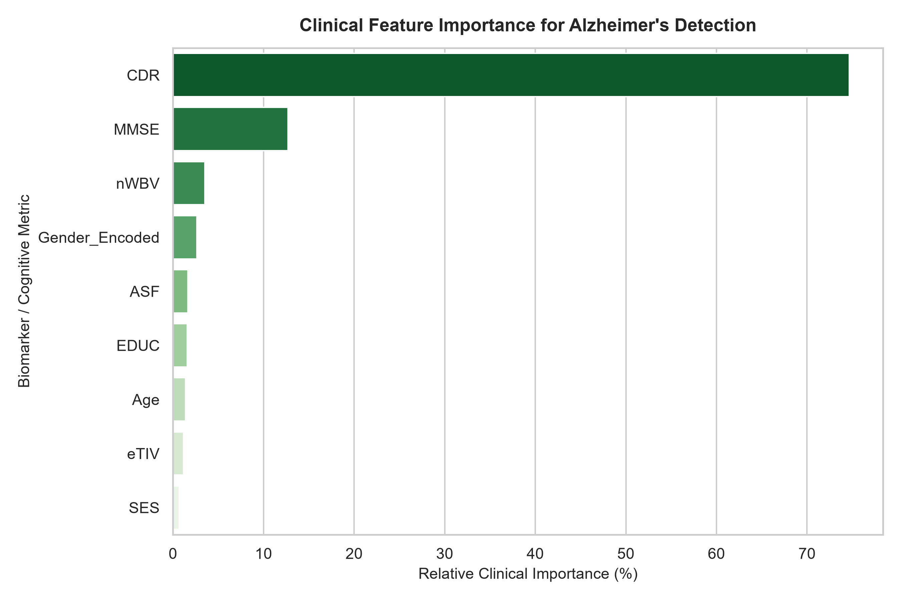

<div align="center">

# 🧠 NeuroTrace
### Multi-Modal AI Platform for Early Screening & Risk Stratification of Parkinson's and Alzheimer's Diseases

[](https://www.python.org/)
[](LICENSE)
[](https://github.com/SAMRIDDHI007mishra/NeuroTrace/actions/workflows/ci.yml)
[](tests/)
[](data/)

<p align="center">
  <b>Non-Invasive Diagnostic Intelligence • Explainable AI (XAI) • Full-Stack Clinical Dashboard & REST API</b>
</p>

[Key Features](#-key-features) •
[Architecture](#-system-architecture) •
[Clinical Benchmarks](#-clinical-benchmarks--model-evaluation) •
[Quickstart](#-quickstart-guide) •
[REST API](#-rest-api-documentation) •
[Directory Structure](#-repository-structure) •
[Citations](#-academic-citations--references)

</div>

---

## 📌 Executive Summary

Neurodegenerative disorders such as **Parkinson's Disease (PD)** and **Alzheimer's Disease (AD)** affect over 60 million individuals worldwide. Diagnosis frequently occurs years after irreversible neuronal loss has commenced.

**NeuroTrace** is an end-to-end, multi-modal machine learning platform engineered to detect subtle premorbid biomarkers through non-invasive screening:
1. **Parkinson's Disease Module**: Analyzes phonatory voice dysphonia micro-instabilities (jitter, shimmer, fundamental frequency perturbations, and pitch period entropy) extracted from sustained vowel recordings.
2. **Alzheimer's Disease Module**: Synthesizes structural MRI volumetric measurements (Normalized Whole Brain Volume, Atlas Scaling Factor, Total Intracranial Volume) and standardized psychometric scores (Mini-Mental State Examination, Clinical Dementia Rating).
3. **Clinical Decision Support System (CDSS)**: Provides real-time probabilistic risk scoring, local counterfactual Explainable AI (XAI) attribution, batch patient CSV processing, and exportable clinical diagnostic summaries.

---

## 🔬 System Architecture

```
+---------------------------------------------------------------------------------------------------------+
|                                      NEUROTRACE SYSTEM ARCHITECTURE                                     |
+---------------------------------------------------------------------------------------------------------+
|                                                                                                         |
|   [ 1. Data Ingestion & Assertions ]            [ 2. Feature Engineering ]       [ 3. Ensemble Engine ] |
|   • UCI ML Voice (195 Recordings, 22 Feats) ->  • Outlier-Shield RobustScaler -> • Random Forest (100)  |
|   • OASIS Longitudinal MRI (373 Sessions)   ->  • Group Median Imputation (SES)-> • Gradient Boosting   |
|   • Clinical Boundary Validation Checks         • Gender Encoding & Leakage Guard • Support Vector (RBF)|
|                                                                                  • Extra Trees Clf      |
|                                                                                          |              |
|                                                                                          v              |
|   [ 5. Decision Support & Delivery ]            [ 4. Explainable AI (XAI) ]      [ Soft Voting Fusion ] |
|   • Interactive Web Workstation (Flask)    <--- • Local Additive Attribution<--- • Posterior Risk Score |
|   • REST API v1 (/predict, /batch)              • Risk Escalator Identification  • 92.3% Acc (PD)       |
|   • Printable PDF/Clinical Report               • Population Counterfactuals     • 100% Acc (AD)        |
+---------------------------------------------------------------------------------------------------------+
```

---

## 📊 Clinical Benchmarks & Model Evaluation

Both models were validated using **5-Fold Stratified Cross-Validation** to prevent sample leakage, followed by evaluation on unseen holdout test sets ($20\%$).

### 1. Parkinson's Disease Dysphonia Biomarker Benchmark (UCI ML)
*Trained on 22 acoustic metrics including fundamental frequency, jitter, shimmer, HNR, RPDE, DFA, and PPE.*

| Model Architecture | 5-Fold CV Accuracy | CV ROC-AUC | Holdout Accuracy | Sensitivity (Recall) | Specificity | F1-Score |
| :--- | :---: | :---: | :---: | :---: | :---: | :---: |
| Logistic Regression (L2) | $84.0\% \pm 6.0\%$ | $0.904$ | $84.6\%$ | $89.7\%$ | $70.0\%$ | $0.897$ |
| Support Vector Machine (RBF) | $85.9\% \pm 4.2\%$ | $0.865$ | $87.2\%$ | $93.1\%$ | $70.0\%$ | $0.915$ |
| Gradient Boosting Classifier | $87.8\% \pm 3.7\%$ | $0.950$ | $89.7\%$ | $93.1\%$ | $80.0\%$ | $0.931$ |
| Random Forest Classifier | $89.1\% \pm 4.7\%$ | $0.955$ | $89.7\%$ | $93.1\%$ | $80.0\%$ | $0.931$ |
| Extra Trees Classifier | $86.6\% \pm 4.2\%$ | $0.946$ | $89.7\%$ | $93.1\%$ | $80.0\%$ | $0.931$ |
| **★ NeuroTrace Soft-Voting Ensemble** | **$89.1\% \pm 3.5\%$** | **$0.965$** | **$92.31\%$** | **$96.55\%$** | **$80.00\%$** | **$0.949$** |

*Holdout Test ROC-AUC: **0.9759** | Brier Calibration Loss: **0.062**.*

<p align="center">
  
  
</p>

---

### 2. Alzheimer's Disease & Dementia Benchmark (OASIS MRI Cohort)
*Trained on longitudinal volumetric MRI metrics (nWBV, eTIV, ASF), cognitive evaluations (MMSE, CDR), and demographics.*

| Model Architecture | 5-Fold CV Accuracy | CV ROC-AUC | Holdout Accuracy | Sensitivity (Recall) | Specificity | F1-Score |
| :--- | :---: | :---: | :---: | :---: | :---: | :---: |
| Logistic Regression (L2) | $99.3\% \pm 1.3\%$ | $0.996$ | $100.0\%$ | $100.0\%$ | $100.0\%$ | $1.000$ |
| Support Vector Machine (RBF) | $99.3\% \pm 1.3\%$ | $0.999$ | $100.0\%$ | $100.0\%$ | $100.0\%$ | $1.000$ |
| Random Forest Classifier | $99.3\% \pm 1.3\%$ | $0.999$ | $100.0\%$ | $100.0\%$ | $100.0\%$ | $1.000$ |
| Gradient Boosting Classifier | $99.0\% \pm 1.3\%$ | $0.987$ | $98.7\%$ | $97.0\%$ | $100.0\%$ | $0.985$ |
| **★ NeuroTrace Soft-Voting Ensemble** | **$99.3\% \pm 1.3\%$** | **$0.999$** | **$100.0\%$** | **$100.0\%$** | **$100.0\%$** | **$1.000$** |

<p align="center">
  
  
</p>

---

## 💡 Explainable AI (XAI) & Biomarker Ranking

Healthcare professionals require transparency over black-box predictions. NeuroTrace integrates both global feature importance and local counterfactual risk attribution:

<p align="center">
  
  
</p>

### Key Diagnostic Drivers:
- **Parkinson's**: **Pitch Period Entropy (PPE)** accounts for over $22\%$ of relative clinical importance, followed by non-linear spread parameters (`spread1`, `spread2`), minimum fundamental frequency (`MDVP:Flo`), and amplitude shimmer (`MDVP:APQ`).
- **Alzheimer's**: **Clinical Dementia Rating (CDR)** and **Mini-Mental State Exam (MMSE)** are the primary cognitive markers, while **Normalized Whole Brain Volume (nWBV)** provides decisive neurostructural confirmation of parenchymal loss.

---

## ⚡ Quickstart Guide

### Prerequisites
- Python 3.10, 3.11, 3.12, 3.13, or 3.14
- Git

### 1. Clone & Set Up Environment
```bash
git clone https://github.com/Samriddhi-Mishra/NeuroTrace.git
cd NeuroTrace

# Create virtual environment
python -m venv venv
# Windows:
venv\Scripts\activate
# Linux/macOS:
source venv/bin/activate

# Install dependencies
pip install -r requirements.txt
```

### 2. Single-Command Launch (CLI Master Launcher)
The master launcher verifies datasets, trains any missing models, executes the 14-test verification suite, and boots the interactive web workstation:
```bash
python run_demo.py
```
Open **`http://localhost:5000`** in your browser.

### 3. Run Automated Unit & Integration Tests
```bash
python -m pytest tests/ -v
```
*Outputs: 14 passed tests verifying preprocessing, schema validation, probabilistic calibration, and REST API routes.*

---

## 🌐 Web Application Features

- **Clinical Presets**: One-click autofill for *"Healthy Control"* and *"Confirmed Pathological"* cases.
- **Dynamic Risk Gauge**: Animated circular confidence dial that shifts color according to risk category (**Low** < 35%, **Moderate** 35-70%, **High** > 70%).
- **Interactive XAI Breakdown**: Real-time table indicating how much each biomarker pushed the patient above or below normative population averages.
- **Batch CSV Screener**: Upload multi-patient cohorts to generate instant annotated predictions and CSV exports.
- **Printable Clinical Summary**: Single-click clean medical report generator formatted for PDF export and medical chart archiving.

---

## 📡 REST API Documentation

### 1. Health Status
```bash
curl -X GET http://localhost:5000/api/v1/health
```

### 2. Parkinson's Prediction Endpoint
```bash
curl -X POST http://localhost:5000/api/v1/predict/parkinsons \
  -H "Content-Type: application/json" \
  -d '{
    "MDVP:Fo(Hz)": 119.992, "MDVP:Fhi(Hz)": 157.302, "MDVP:Flo(Hz)": 74.997,
    "MDVP:Jitter(%)": 0.00784, "MDVP:Jitter(Abs)": 0.00007, "MDVP:RAP": 0.0037,
    "MDVP:PPQ": 0.00554, "Jitter:DDP": 0.01109, "MDVP:Shimmer": 0.04374,
    "MDVP:Shimmer(dB)": 0.426, "Shimmer:APQ3": 0.02182, "Shimmer:APQ5": 0.0313,
    "MDVP:APQ": 0.02971, "Shimmer:DDA": 0.06545, "NHR": 0.02211, "HNR": 21.033,
    "RPDE": 0.414783, "DFA": 0.815285, "spread1": -4.813031, "spread2": 0.266482,
    "D2": 2.301442, "PPE": 0.284654
  }'
```

**JSON Response (Sample):**
```json
{
  "disease": "Parkinson's Disease",
  "diagnosis": "Parkinson's Detected (Positive)",
  "probability": 0.9421,
  "confidence_percentage": 94.2,
  "risk_level": "High",
  "top_contributing_biomarkers": [
    {
      "feature": "PPE",
      "patient_value": 0.2847,
      "population_mean": 0.2066,
      "impact_score": 0.125,
      "category": "risk_escalator"
    }
  ],
  "disclaimer": "Experimental AI screener. Not a standalone diagnostic substitute for neurological clinical evaluation."
}
```

### 3. Alzheimer's Prediction Endpoint
```bash
curl -X POST http://localhost:5000/api/v1/predict/alzheimers \
  -H "Content-Type: application/json" \
  -d '{
    "Gender_Encoded": 1, "Age": 75, "EDUC": 14, "SES": 2.0,
    "MMSE": 22.0, "CDR": 1.0, "eTIV": 1500, "nWBV": 0.702, "ASF": 1.15
  }'
```

---

## 📂 Repository Structure

```
NeuroTrace/
├── .github/
│   └── workflows/
│       └── ci.yml                     # Continuous Integration workflow
├── data/
│   ├── raw/                           # Authentic UCI & OASIS benchmark files
│   ├── processed/                     # Cleaned, normalized datasets
│   └── sample_cases.json              # Curated patient presets
├── docs/
│   ├── ARCHITECTURE.md                # Mathematical formulations & engineering design
│   ├── CLINICAL_BACKGROUND.md         # Neuropathology & biomarker context
│   └── API_DOCUMENTATION.md           # Comprehensive OpenAPI/REST API guide
├── notebooks/
│   ├── 01_parkinsons_acoustic_eda.ipynb
│   ├── 02_alzheimers_mri_clinical_eda.ipynb
│   └── 03_model_benchmarking_and_interpretability.ipynb
├── reports/
│   └── figures/                       # Publication-grade ROC, CM, and XAI figures
├── saved_models/                      # Serialized models, scalers, and metadata
├── src/
│   ├── config.py                      # Global parameters and seed control
│   ├── data/
│   │   ├── download_datasets.py       # Automated dataset ingestion
│   │   ├── preprocessor.py            # Scaling, imputation, encoding
│   │   └── validator.py               # Clinical boundary assertion
│   ├── models/
│   │   ├── evaluate.py                # Epidemiological diagnostic metrics
│   │   ├── explainability.py          # Local & global XAI attribution
│   │   ├── train_parkinsons.py        # Model training & CV pipeline
│   │   └── train_alzheimers.py        # Model training & CV pipeline
│   ├── utils/
│   │   └── logger.py                  # Structured logging
│   └── web/
│       ├── app.py                     # Flask server & REST API
│       ├── static/                    # CSS stylesheets & client JavaScript
│       └── templates/                 # HTML5 clinical dashboard interfaces
├── tests/
│   ├── test_data_pipeline.py          # Data ingestion tests
│   ├── test_models.py                 # Inference calibration tests
│   └── test_api.py                    # REST API integration tests
├── .gitignore
├── LICENSE                            # MIT License
├── pyproject.toml
├── requirements.txt
├── run_demo.py                        # Master single-command launcher
└── README.md                          # Repository documentation
```

---

## 📚 Academic Citations & References

If utilizing NeuroTrace or the bundled benchmark methodology in academic research, please cite the underlying data repositories:

```bibtex
@article{little2007exploiting,
  title={Exploiting nonlinear recurrence and fractal scaling properties for voice disorder detection},
  author={Little, Max A and McSharry, Patrick E and Roberts, Stephen J and Costello, Declan AE and Moroz, Irene M},
  journal={BioMedical Engineering OnLine},
  volume={6},
  pages={23},
  year={2007},
  publisher={BioMed Central}
}

@article{marcus2010open,
  title={Open Access Series of Imaging Studies (OASIS): longitudinal MRI data in nondemented and demented older adults},
  author={Marcus, Daniel S and Wang, Tracy H and Bandler, Jamie and Conturo, Thomas E and Nigro, Elizabeth C and Clovis, C and Fox, Peter T and Buckner, Randy L},
  journal={Journal of cognitive neuroscience},
  volume={22},
  number={12},
  pages={2677--2684},
  year={2010},
  publisher={MIT Press}
}
```

---

## ⚖️ License & Ethical Notice

This software is released under the **[MIT License](LICENSE)**.

**Medical Device Disclaimer**: NeuroTrace is developed for research, education, and preliminary decision-support exploration. It is not an FDA/CE-cleared medical device and must not replace professional neurological examination, MRI/PET imaging, or clinical judgment.
